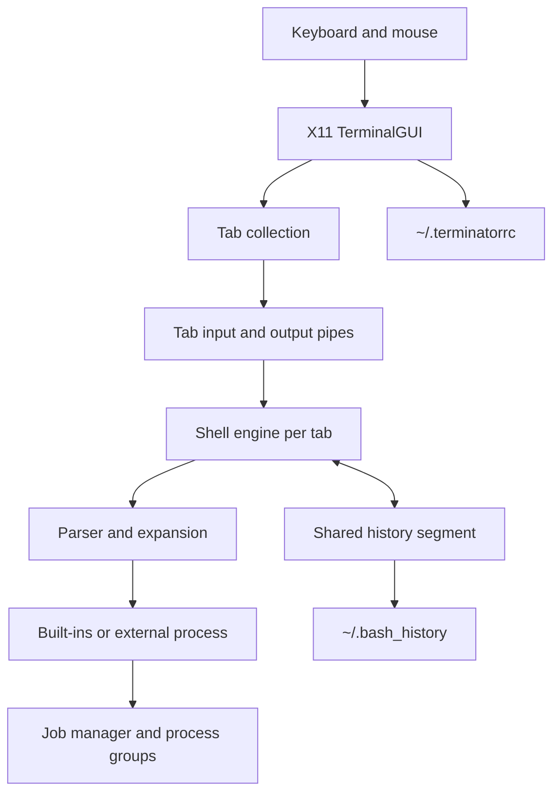
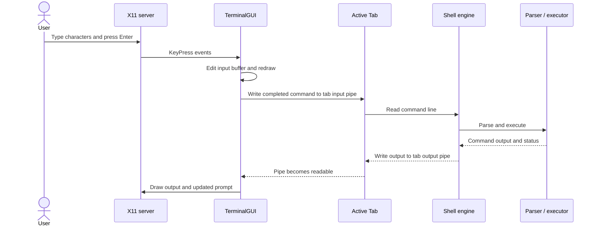

# Terminator: A Custom Terminal Emulator and Shell

**Computing Lab (CS69201) · Term Project**

Terminator is a Linux terminal emulator and shell implemented in C++ using Xlib and POSIX system calls. It renders an X11 window with multi-tab support and provides an interactive bash-like shell environment supporting pipes, redirection, job control, shared command history, auto-completion, multiline input, and custom hotkeys.

---

## 1. Project Overview

Terminator combines the functionality of a terminal emulator (rendering graphical X11 window, capturing keyboard events, drawing text buffers) with a full-featured POSIX command shell (process management, pipelines, I/O redirection, signal forwarding, and job control).

Key capabilities:
- **X11 GUI & Multi-tab support**: Independent shell instances running concurrently across multiple tabs. Tabs keep running in background while another is focused.
- **Dual Execution Modes**: Thread Mode (default) and Process Mode (`useProcess=True`).
- **Synchronized Shared History**: POSIX shared memory (`shm_open`, `mmap`) protected by a process-shared semaphore (`sem_t`).
- **Bash-style Quoting & Multiline Input**: Handles line continuations (`\`), multiline quotes (`'` and `"`), nested command substitutions (`$(...)` and backticks), and environment variable expansions (`$VAR`, `$?`).
- **I/O Redirections & Arbitrary Pipelines**: Full support for `<`, `>`, `>>`, and arbitrary `N` command pipelines with `N-1` pipes using `dup2()`.
- **Parallel multiWatch**: Monitored concurrent command execution using `poll()` with periodic re-execution and formatted output.
- **Configurable Hotkeys**: Bash editing keys loaded dynamically from `~/.terminatorrc` with conflict validation.
- **Signal Handling & Job Control**: `Ctrl+C` interrupt, `Ctrl+Z` suspension, `cmd &` backgrounding, and `jobs`, `fg`, `bg` built-ins.

---

## 2. Dependencies and Installation

Terminator relies on standard Linux POSIX libraries and Xlib (X11 client library).

### Required Packages (Ubuntu / Debian):
```bash
sudo apt update
sudo apt install build-essential libx11-dev
```

- **Compiler**: `g++` (C++17 or later)
- **Libraries**:
  - `libX11` (`-lX11`) — X Window System client library
  - `pthread` (`-lpthread`) — POSIX threads & semaphores
  - `rt` (`-lrt`) — Realtime POSIX extensions (shared memory)

---

## 3. Building the Project

A `Makefile` is provided in the repository root.

To compile:
```bash
make
```

To run the automated verification test suite:
```bash
make test
```

To clean build artifacts:
```bash
make clean
```

This generates the `./terminator` executable.

---

## 4. Running Terminator

Terminator supports two distinct execution architectures:

### Mode 1: Thread Mode (Default)
In thread mode, Terminator runs as a single process where each tab operates within an independent POSIX thread (`pthread_create`). All tabs share memory, while history is synchronized via semaphores.

```bash
./terminator
```

### Mode 2: Process Mode
In process mode, the GUI runs in the parent process, and each new tab forks into an independent child process (`fork()`) communicating with the GUI via IPC pipes. Shared state such as history is maintained in POSIX shared memory (`mmap`) protected by a process-shared semaphore.

```bash
./terminator useProcess=True
```

---

## 5. Feature Highlights & Tasks Implemented

### Task 1: X11 GUI and Tabs
- Rendered using pure Xlib primitives (`XOpenDisplay`, `XCreateSimpleWindow`, `XDrawString`, `XFillRectangle`).
- Event loop blocks on `poll()` on the X11 connection descriptor and tab output pipes—**zero busy-waiting**.
- Dynamic tab bar displaying `[ 1: ~/dir ] [ 2: /tmp ] [ + ]`.
- Tabs can be created by clicking `[ + ]` or via hotkeys, closed, and switched by clicking tabs.
- Smooth mouse-wheel scrolling (Button 4/5).

### Task 2: Built-in & External Commands
- External commands execute via `fork()` + `execvp()`.
- Built-ins implemented:
  - `cd [dir]`: Changes directory for the active tab only; supports `~` expansion and relative paths.
  - `exit`: Closes the current tab.
  - `history`: Lists chronological command history shared across all tabs.
  - `multiWatch ["cmd1", "cmd2", ...]`: Concurrent command monitor.
  - `jobs`, `fg [%id]`, `bg [%id]`: Job control management.
  - `source <script>`: Executes bash scripts line by line.
  - `pwd`: Prints current tab working directory.
- Unknown commands display `terminator: <cmd>: command not found` and record exit status in `$?`.

### Task 3: Multiline Input and Quoting
- Detects unclosed quotes (`'`, `"`), unclosed command substitutions (`$(...)`, `` `...` ``), and trailing continuation slashes (`\`).
- Prompts with continuation indicator `> ` until statement is syntactically complete.
- Strictly adheres to bash quoting semantics: single quotes are literal; double quotes evaluate `$VAR`, `$?`, and command substitutions.

### Task 4: I/O Redirection
- Supports `<`, `>`, and `>>` alone or in combination.
- Validates missing input files upfront before launching children.
- Background jobs reading the same file run independently without mutual interference.

### Task 5: Arbitrary Command Pipelines
- Supports pipelines of arbitrary length: $N$ commands connected via $N-1$ pipes.
- Pipeline stages are combined with I/O redirections seamlessly.

### Task 6: multiWatch
- `multiWatch ["cmd1", "cmd2", ...]` executes commands concurrently in separate processes.
- Gathers output via dedicated pipes using non-busy-wait `poll()`.
- Re-executes finished commands every 2 seconds by default.
- Formatted output matching the required specification:
  ```text
  "cmd1", <unix_timestamp>:
  ----------------------------------------------------
  <output>
  ----------------------------------------------------
  ```
- Gracefully handles `Ctrl+C` to terminate watched commands and returns prompt to shell.

### Task 7: Hotkeys & Custom Configuration
- Configurable via `~/.terminatorrc` with conflict validation.
- Default hotkey bindings:
  - `Left` / `Right`: Move cursor within input line.
  - `Ctrl+A` / `Ctrl+E`: Jump to beginning / end of line.
  - `Up` / `Down`: Traverse command history.
  - `Ctrl+U` / `Ctrl+K`: Delete from cursor to start / end of line.
  - `Ctrl+W`: Delete previous word.
  - `Ctrl+L`: Clear screen.
  - `Ctrl+D`: Close tab / EOF.
  - `Ctrl+Shift+C` / `Ctrl+Shift+V`: X11 clipboard copy and paste.

### Task 8: Signals & Job Control
- `Ctrl+C`: Terminates foreground process group (`SIGINT`). Terminator itself never stops.
- `Ctrl+Z`: Suspends foreground process group (`SIGTSTP`) and registers it in the job table.
- Background execution: Suffixing command with `&` runs it asynchronously.
- `jobs`: Inspect active background and stopped jobs.
- `fg`: Bring job to foreground.
- `bg`: Resume stopped job in background.

### Task 9: Searchable, Persistent History
- Commands are shared across tabs and retained in `~/.bash_history` (up to 10,000 entries).
- `history` displays the most recent 1,000 entries.
- `Ctrl+R` prompts for a term, preferring its newest exact command match; otherwise it displays commands tied for the longest common substring when that substring is longer than two characters.

### Task 10: File-name Completion
- `Tab` completes file and directory names relative to the active tab's directory, preserving text after the cursor.
- One match completes directly; multiple matches expand to their common prefix and show numbered choices that can be selected with `1`–`9`.

### Task 11: Bash Script Interpreter
- `source file.sh`, `bash file.sh`, and `./file.sh` execute through Terminator's interpreter.
- Supports sequential commands, comments, assignments, `$NAME`, `$1`–`$9`, `$#`, `$?`, nested `if`/`elif`/`else`/`fi`, `[ ... ]` integer/string and file/directory tests, pipelines, redirection, substitutions, and script `exit`.
- Loops and functions are not implemented.

---

## 6. Known Limitations

- Interactive terminal applications that require full pseudoterminal (`pty`) ioctls (such as `vim`, `htop`, or `nano` screen manipulation) run in line-mode rather than raw ncurses curses mode, as specified in the assignment constraints using standard pipes.
- Font rendering utilizes standard X11 core fonts (`9x15` or `fixed`). TrueType antialiased fonts require `Xft` which is not a part of baseline Xlib.

---

## 7. Sample Usage Demo

Run sample demo script via Terminator:
```bash
user@terminator> source test_demo.sh
```

Inspect history across tabs:
```bash
user@terminator> history
```

---

## 8. Architecture at a Glance

The application has a graphical front end, one shell engine per tab, and shared history.
The selected execution mode changes how each tab engine is hosted.



### Execution mode flow

```text
Thread mode
  X11 GUI process
    ├── tab 1 worker thread ── shell state and command children
    ├── tab 2 worker thread ── shell state and command children
    └── shared history protected by process-shared semaphore

Process mode
  X11 GUI parent
    ├── tab 1 worker process ── shell state and command children
    ├── tab 2 worker process ── shell state and command children
    └── shared history mapped by each process and semaphore protected
```

Each tab keeps its own working directory, input line, scrollback, and shell jobs.
The GUI owns the X11 window and chooses which tab receives keyboard input.
The shell sends output and title updates to the GUI through its tab connection.

## 9. Repository Map

| Path | Responsibility |
| --- | --- |
| `src/main.cpp` | Parses startup options and launches the GUI. |
| `src/gui.cpp`, `src/gui.hpp` | X11 window, event loop, rendering, hotkeys, and tab routing. |
| `src/tab.cpp`, `src/tab.hpp` | Per-tab worker setup, pipe endpoints, and tab state. |
| `src/shell.cpp`, `src/shell.hpp` | Shell command execution and built-in dispatch. |
| `src/parser.cpp`, `src/parser.hpp` | Tokenization, quoting, expansion, and command structure. |
| `src/jobs.cpp`, `src/jobs.hpp` | Background and stopped job tracking. |
| `src/history.cpp`, `src/history.hpp` | Shared and persistent command history. |
| `src/autocomplete.cpp`, `src/autocomplete.hpp` | Command and path completion. |
| `src/multiwatch.cpp`, `src/multiwatch.hpp` | Concurrent command monitoring. |
| `src/config.cpp`, `src/config.hpp` | Hotkey configuration loading and validation. |
| `tests/` | Unit and comprehensive test programs. |
| `test_demo.sh` | Demonstration script for the shell features. |
| `Makefile` | Build, test, and cleanup targets. |

## 10. Data and Control Flow

### From key press to command



### Output readiness

The GUI waits for X11 events and tab output with `poll()`.
This lets the window respond to input while shell output arrives asynchronously.
When a tab pipe closes, the GUI can notice the hangup and remove the finished tab.

## 11. Build and Runtime Notes

The Makefile compiles the C++17 translation units under `src/` and links Xlib,
POSIX threads, and the realtime library. `make test` builds the test runner from
the implementation modules without the GUI or application entry point.

Typical development cycle:

```text
Edit C++ source or headers
        │
        ▼
      make ───────► terminator executable
        │
        ├── make test ──► test_runner executes, then is removed
        │
        └── make clean ─► remove object files and generated binaries
```

The `sample.terminatorrc` file demonstrates configurable editing keys.
Copy the desired settings to `~/.terminatorrc` to use them for your account.
The configuration is loaded when the application initializes.

## 12. Troubleshooting

| Symptom | Check |
| --- | --- |
| `XOpenDisplay` cannot connect | Start Terminator in a graphical X11 session and check `DISPLAY`. |
| Xlib header is missing | Install the platform's X11 development package, such as `libx11-dev`. |
| Linker cannot find X11 | Confirm the X11 development libraries are installed. |
| A command is not found | Check spelling and whether its executable directory is in `PATH`. |
| A script does not run | Check its path, permissions, and supported syntax subset. |
| Hotkey settings are ignored | Check `~/.terminatorrc` syntax and look for conflicting bindings. |
| A tab appears stuck | Inspect whether its foreground child is waiting for input or still running. |

## 13. Scope and Extension Points

The project is structured so interface, shell, and support features can evolve
independently. New X11 interactions belong in the GUI event handlers; shell
syntax belongs in the parser and executor; stateful shell behavior belongs in
the shell or job manager; and persistent cross-tab command data belongs in the
history manager.

Potential extensions that fit the current boundaries include richer font
rendering, terminal escape-sequence support, more shell grammar, and additional
completion sources. These would require coordinated updates to the relevant
module and its documentation or tests.

The current design intentionally uses pipes for tab communication and command
I/O. As a result, applications expecting a full pseudo-terminal device do not
receive all terminal control behavior. See the limitations section above before
using Terminator for interactive full-screen programs.

