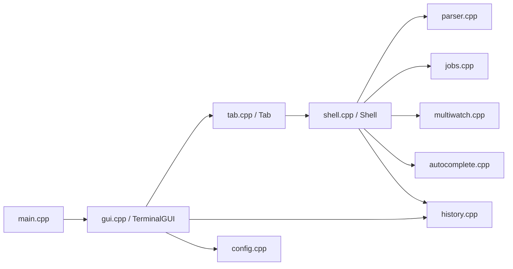
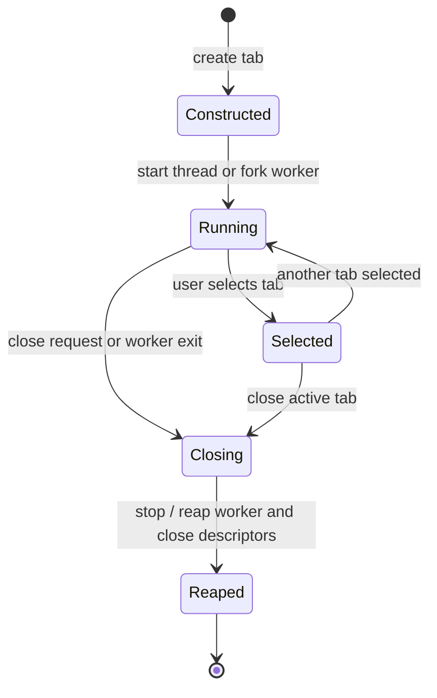
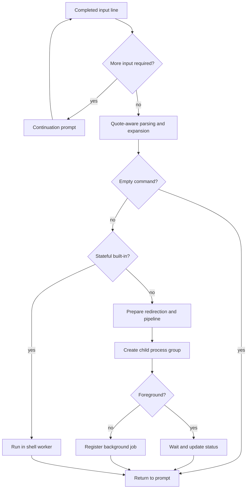
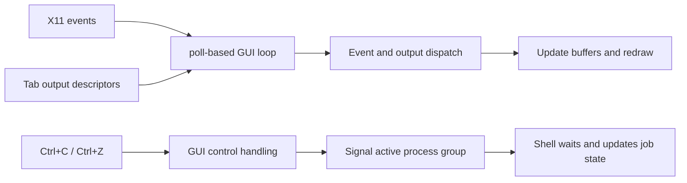
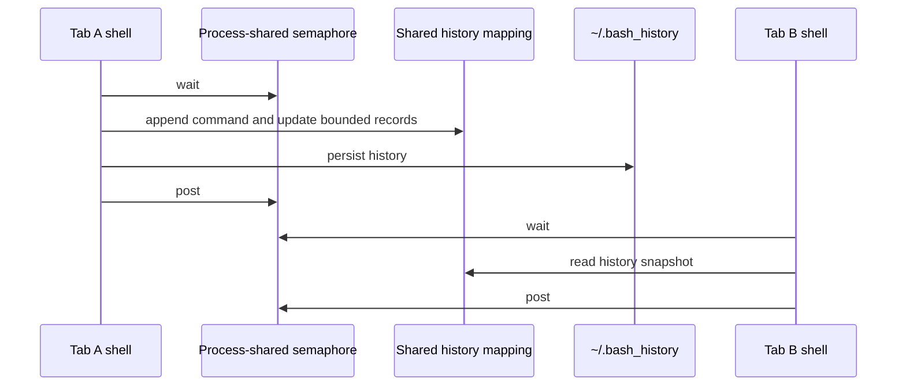

# Terminator Design Document

**Course**: Computing Lab (CS69201) · Term Project  
**Project**: Terminator: A Custom Terminal Emulator and Shell in C++  

---

## 1. System Architecture

Terminator is designed with a strictly decoupled architecture: the **X11 GUI Front-End** manages window creation, user keyboard input, and graphical rendering, while the **Tab Shell Engines** manage process creation, pipes, command execution, and shell state.

```
                      +-----------------------------+
                      |      X11 GUI Front-End      |
                      |  (Window, Tab Bar, Screen)  |
                      +--------------+--------------+
                                     |
              +----------------------+----------------------+
              |                                             |
        [Thread Mode]                                 [Process Mode]
    pthread_create worker                          fork child worker
              |                                             |
              +--------------+------------------------------+
                             | Bidirectional IPC Pipes
                             v
                      +-----------------------------+
                      |      Tab Shell Engine       |
                      | (cd, pipes, multiWatch,     |
                      |  job control, parsing, etc) |
                      +--------------+--------------+
                                     |
                      +--------------v--------------+
                      |    POSIX Shared Memory      |  <-- Shared History
                      |  (shm_open + mmap + sem_t)  |
                      +-----------------------------+
```

---

## 2. X11 GUI and Event Loop Design

### 2.1 Non-Busy-Wait Event Loop
Terminator avoids 100% CPU utilization by avoiding busy-wait polling loops. The core event loop employs the `poll()` system call:
1. File descriptors collected:
   - The X11 connection socket: `ConnectionNumber(display)`.
   - The read-ends of output pipes for all active tabs (`from_tab_fd_`).
2. The loop sleeps inside `poll(pfds, count, timeout_ms)`:
   - When the X server has pending events (`POLLIN` on X11 socket), `XPending(display)` and `XNextEvent(display, &event)` process the events.
   - When any shell produces output (`POLLIN` on a tab pipe), the GUI reads non-blockingly and appends text to that tab's screen line buffer.
   - If a tab terminates or crashes (`POLLHUP`), the GUI safely reaps and closes the tab.

### 2.2 Graphical Interface Elements
- **Tab Bar**: Drawn along the top with coordinates `0, 0` to `width, 28`. Renders active tabs in the exact specification format: `[ 1: ~/Downloads ] [ 2: /tmp ] [ + ]`.
- **Text Rendering**: Mono-spaced font `9x15` (fallback to `fixed`). Character metrics (`char_width`, `char_height`, `char_ascent`) determine baseline positioning.
- **Color Scheme**: High-contrast modern palette:
  - Background: `#1e1e1e` (dark charcoal)
  - Foreground Text: `#d4d4d4` (light gray)
  - Prompt: `#50fa7b` (vibrant green)
  - Cursor: `#00bcd4` (cyan solid block)
  - Active Tab: `#3c3836`
- **Scrolling**: Backlog buffer maintains up to 5,000 lines per tab. Mouse wheel buttons (Button 4 for up, Button 5 for down) increment/decrement `scroll_offset`.

---

## 3. Execution Modes & Shared State Synchronization

### 3.1 Thread Mode (Default: `./terminator`)
- The terminal runs as a single process.
- Each new tab launches a POSIX worker thread via `pthread_create()`.
- Bidirectional pipes (`pipe()`) connect the GUI to the thread's shell engine.
- Memory is shared within the process address space.

### 3.2 Process Mode (`./terminator useProcess=True`)
- The parent process hosts the X11 GUI only.
- Each new tab executes `fork()` to spawn an independent process and establishes process group isolation (`setpgid(0, 0)`).
- The GUI communicates with tab processes through IPC pipes.
- Crashes in one tab do not affect other tabs or the GUI parent.

### 3.3 Shared History Synchronization
Both execution modes share a single synchronized history store using POSIX Shared Memory:
- **Shared Segment**: Allocated via `shm_open()` and mapped via `mmap()` using the `SharedHistoryLayout` struct.
- **Process-Shared Semaphore**: An embedded `sem_t lock` is initialized with `pshared = 1` via `sem_init(&shared_data->lock, 1, 1)`.
- **Mutual Exclusion**: Any tab wanting to read (`getAll()`, `get()`) or append (`add()`) calls `sem_wait(&shared_data->lock)` and `sem_post(&shared_data->lock)`.
- Commands entered in Tab 1 immediately become visible to Tab 2 through the shared memory array.

---

## 4. Shell Engine & Process Management

### 4.1 Built-in Commands vs. External Commands
Commands that modify shell process state are executed as built-ins:
- `cd [dir]`: Changes only the active tab's internal working directory (`cwd_`). Emits an OSC title update sequence back to the GUI.
- `exit`: Sends an exit signal to GUI to destroy the active tab.
- `history`: Formats and displays the shared memory command history.
- `jobs`: Polls child status and lists active/stopped background jobs.
- `fg [%id]`: Resumes stopped jobs in foreground using `kill(-pgid, SIGCONT)` and `waitpid()`.
- `bg [%id]`: Resumes stopped jobs in background.
- `source <file>`: Reads and evaluates commands sequentially.
- `multiWatch`: Runs parallel watched commands.

External commands run in a child created with `fork()` + `execvp()`. The shell waits for them or places them in background depending on the `&` token.

---

## 5. IPC, Redirection & Pipelines

### 5.1 Redirection (`<`, `>`, `>>`)
- Before forking, Terminator verifies input file existence via `stat()`. If missing, it outputs an error without spawning children.
- In the child process:
  - Input redirection: `open(file, O_RDONLY)` followed by `dup2(fd, STDIN_FILENO)`.
  - Output redirection: `open(file, O_WRONLY | O_CREAT | (append ? O_APPEND : O_TRUNC), 0666)` followed by `dup2(fd, STDOUT_FILENO)`.

### 5.2 Arbitrary Pipelines
- For $N$ commands, Terminator creates $N-1$ pipes via `pipe()`.
- Each command forks into a dedicated child process.
- All children are added to the same Process Group (`pgid = first_child_pid`).
- Child $i$ redirects `STDIN_FILENO` to `pipes[i-1][0]` and `STDOUT_FILENO` to `pipes[i][1]`.
- Parent and child processes systematically close unused pipe descriptors to prevent pipe descriptor leaks and deadlocks.

---

## 6. multiWatch Implementation

`multiWatch ["cmd1", "cmd2", ...]` runs all target commands simultaneously:
- Each command is launched in its own process group via `fork()` + `execl("/bin/sh", "sh", "-c", cmd)`.
- The child process redirects stdout and stderr to the write-end of a dedicated pipe.
- The parent monitors all pipe read-ends simultaneously using `poll()` with non-busy-wait timeout.
- When output is received or a child finishes, Terminator reaps it and formats the output with unix timestamp:
  ```text
  "cmd1", 1790860020:
  ----------------------------------------------------
  <command output>
  ----------------------------------------------------
  ```
- Every 2 seconds (`MULTIWATCH_INTERVAL_SEC`), completed commands automatically re-launch.
- Upon receiving `Ctrl+C`, the parent terminates every watched child with `kill(-pid, SIGTERM)` and returns prompt to the shell.

---

## 7. Data Structures & Algorithms

### 7.1 Autocomplete
- When cursor is on the first token: scans built-in list and all executable files across `PATH` directories via `opendir()` / `readdir()`.
- When cursor is on subsequent tokens: scans current directory for matching files and subdirectories.
- Calculates longest common prefix across matches to partially expand input if multiple options exist.

### 7.2 Multiline & Quoting Parser
- Uses a deterministic state scanner tracking:
  - Quote state (`in_single_quote`, `in_double_quote`, `in_backtick`)
  - Escape state (`escaped`)
  - Subshell depth stack for nested `$(...)`
- Distinguishes literal single quotes from double quotes that expand variables.

---

## 8. Signal Handling & Job Control

- **Event-Driven Signals**: Keys like `Ctrl+C` and `Ctrl+Z` are captured as X11 events by the GUI. The shell dispatches them directly using `kill(-pgid, SIGINT)` or `kill(-pgid, SIGTSTP)`.
- **Terminator Resilience**: Terminator never terminates upon `Ctrl+C` or `Ctrl+Z`. Only the foreground process group is affected.
- **Job Control Table**: `JobManager` tracks jobs by PGID, child PIDs, command text, and state (`RUNNING`, `STOPPED`). Updates non-blockingly via `waitpid(-1, &status, WNOHANG | WUNTRACED | WCONTINUED)`.

## 9. Searchable History, Completion, and Scripts

- The shared history segment holds the latest 10,000 entries. The parent initializes it from `~/.bash_history`; each accepted command updates that file while holding the process-shared semaphore. `history` limits output to the newest 1,000 entries. Ctrl+R collects a search term, selects the newest exact match, or displays entries tied for the longest common substring (minimum length three).
- File completion scans the active tab's working directory, expands the common prefix, and prints numbered alternatives when ambiguous. The GUI keeps the untouched suffix of the input line and accepts a numbered choice.
- Script entry points (`source`, `bash file`, and `./file.sh`) use the internal command executor. The interpreter validates balanced `if`/`fi` blocks before execution, then handles nested conditionals, assignments, positional parameters, file/directory and comparison tests, and `exit`. The parser/executor supplies command substitutions, pipes, and redirections. Loops and functions are outside the required subset.

## 10. Module Boundaries and Ownership

The implementation is split into modules with narrow responsibilities. The GUI
owns the X11 resources and tab objects; each tab owns its input/output channel
and worker lifecycle; shell code owns command state and dispatch; helper modules
provide parsing, jobs, history, completion, configuration, and multiWatch.



The arrows show the principal dependency and call direction, not every helper
function call. Shared declarations and common constants live in the headers
under `src/`; implementation details remain in the corresponding `.cpp` files.

| Module | State primarily managed | Main collaborators |
| --- | --- | --- |
| `main` | Startup mode | `TerminalGUI` |
| `gui` | Window, active tab, drawing and input state | `Tab`, `HistoryManager`, `HotkeyConfig` |
| `tab` | Per-tab worker and pipe endpoints | `Shell` |
| `shell` | Working directory, environment, status, command dispatch | Parser, jobs, history, multiWatch |
| `parser` | Parsed command representation and expansions | Shell execution path |
| `jobs` | Process groups and job state | Shell process control |
| `history` | Shared-memory records and persistence | GUI and shell |
| `autocomplete` | Candidate discovery and common prefix | GUI input editing |
| `config` | Key-to-action bindings | GUI event dispatch |
| `multiwatch` | Watched commands, pipes, and timers | Shell execution |

## 11. Tab Lifecycle

Creating and closing a tab crosses the GUI and worker boundary. The GUI retains
the tab object and uses its descriptors to route input and collect output.



For thread mode, the worker shares the GUI process address space. For process
mode, the worker has a separate address space and communicates over pipes.
Both modes expose the same conceptual tab interface to the GUI.

### Pipe directions

```text
GUI input buffer ──write──► tab command input ──read──► shell worker
GUI screen buffer ◄─read─── tab output pipe   ◄─write── shell worker
```

The GUI drains output when descriptors are readable. Closing the tab must also
stop or join/reap its worker as appropriate, and close both sides of its IPC
descriptors so that no stale endpoint keeps a pipe alive.

## 12. Command Processing Stages

The command path proceeds from a completed input line through parsing and
execution. A single command may branch into built-in handling or process setup.



Built-ins that change shell state, such as `cd`, must run in the shell worker so
their effects persist in that tab. External commands execute in child processes.
The last command's result updates the shell status used by `$?`.

## 13. Pipeline and Redirection Descriptor Map

For a pipeline of three commands, the parent creates two pipes. Each child keeps
only the descriptors it needs after `dup2()` and closes unused pipe ends.

```text
               pipe 0                         pipe 1
          ┌──────────────┐                ┌──────────────┐
stdin ──► [ command A ] ─┼──► [ command B ] ─┼──► [ command C ] ──► stdout
          └──────────────┘                └──────────────┘
                  │                               │
             close unused                    close unused
```

Input and output redirections are applied to the relevant command descriptors.
When a redirection replaces a pipeline endpoint, normal descriptor setup rules
determine which source feeds the command. Descriptor closure is important:
an unused write end can prevent a downstream reader from seeing end-of-file.

## 14. Event and Signal Flow

The graphical event loop watches the X connection and tab output descriptors.
The GUI translates terminal control keys into shell control messages or process
signals for the active foreground group.



The GUI remains responsible for the window event loop. Process status changes
are observed with nonblocking wait operations in the shell/job-management path.
Foreground waiting and background status checks must not consume the same child
status twice; this is why job operations are centralized around process IDs and
process groups.

## 15. Shared History Lifecycle

Shared history makes commands available across tabs and, in process mode, across
worker processes. The semaphore guards shared memory updates and reads.



The fixed limits in `common.hpp` bound shared-memory usage. A reader should copy
the needed records while holding the lock and then format or display them after
releasing it, keeping the critical section short.

## 16. Failure Handling and Resource Rules

System calls can fail because of unavailable resources, invalid paths, child
process errors, or a missing X server. The surrounding module should report a
useful error and preserve cleanup paths for descriptors and children.

| Boundary | Failure example | Expected handling |
| --- | --- | --- |
| Startup | No usable X display | Report initialization failure and exit cleanly. |
| Tab creation | Pipe, fork, or thread creation fails | Avoid publishing a half-initialized tab. |
| Command launch | `fork()` or `execvp()` fails | Report the error and return a nonzero status. |
| Redirection | File cannot be opened | Report the path error and avoid running with unintended streams. |
| Child lifecycle | Child exits or stops | Reap status and update the associated job. |
| Tab shutdown | Worker exits or user closes tab | Close endpoints and release worker resources. |
| History | Shared-memory setup fails | Handle initialization failure without invalid mapping access. |

Resource ownership should remain local: GUI resources are released by the GUI,
tab descriptors by the tab lifecycle, and child statuses by the shell/job code.
This makes failure cleanup easier to reason about than relying on process exit
to reclaim every resource.

## 17. Build and Verification Structure

The `Makefile` compiles each implementation file using C++17 and links the
application with X11, pthreads, and `rt`. The test target links the reusable
implementation modules while excluding `main.cpp` and `gui.cpp`.

```text
src/*.cpp ──compile──► src/*.o ──link with X11/pthread/rt──► terminator
                              └──test sources + non-GUI objects──► test_runner
```

`make clean` removes generated object files and executables. Tests are organized
into unit-level and comprehensive suites under `tests/`; the demo script gives
a practical path through representative shell commands.

## 18. Design Constraints and Future Work

The current renderer uses Xlib core drawing and pipes rather than a pseudoterminal.
Those choices keep the implementation focused on the project requirements, but
they constrain compatibility with full-screen terminal programs and advanced
font rendering.

Any extension should preserve the separation between presentation and command
execution. For example, a future pseudo-terminal layer would change tab I/O and
process setup, while leaving tab selection and much of the X11 drawing code
independent. Additional shell syntax belongs in the parser and executor, with
tests covering quoting, error paths, and interactions with redirection.

The diagrams describe the intended module and data flow at the time of writing.
When implementation boundaries or behavior change, update the relevant diagram
and module table alongside the code so this document remains useful to maintainers.

